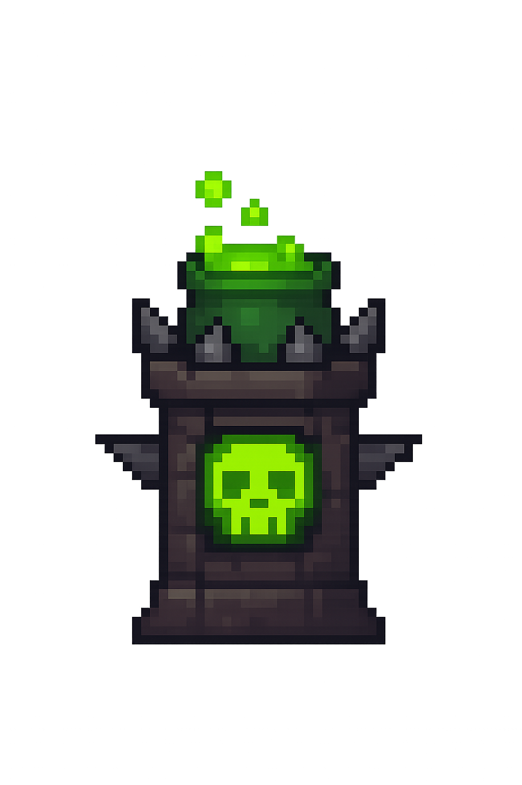
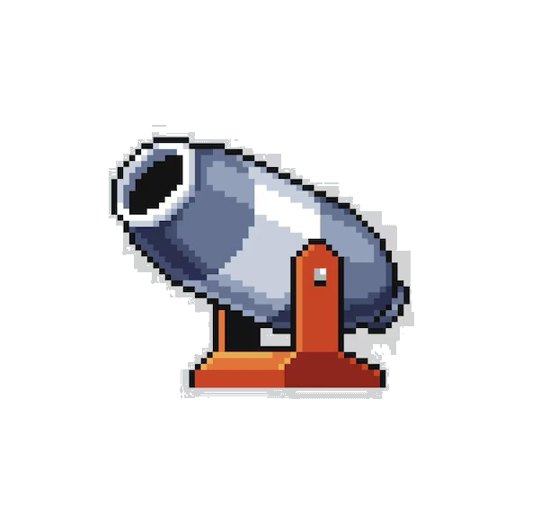
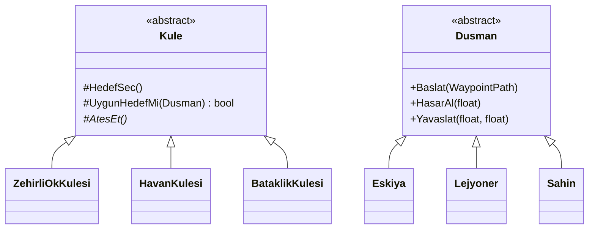
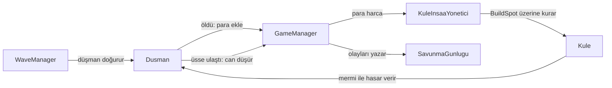

<div align="center">


# Düşman Avcısı

**Unity 6 ile geliştirilmiş, dalga tabanlı 2D kule savunma oyunu.**

Kuleni seç, stratejik noktalara yerleştir, kaleye ulaşmaya çalışan düşman dalgalarını durdur.


</div>

---

## İçindekiler

- [Özellikler](#özellikler)
- [Nasıl Oynanır](#nasıl-oynanır)
- [Kuleler](#kuleler)
- [Düşmanlar](#düşmanlar)
- [Dalgalar ve Ekonomi](#dalgalar-ve-ekonomi)
- [Kurulum](#kurulum)
- [Mimari](#mimari)
- [Proje Yapısı](#proje-yapısı)
- [Savunma Günlüğü](#savunma-günlüğü)
- [Bilinen Sorunlar](#bilinen-sorunlar)
- [Lisans](#lisans)

## Özellikler

- **3 farklı kule:** tekil hedef, alan hasarı ve yavaşlatma odaklı savunma seçenekleri
- **3 farklı düşman:** standart, zırhlı ve uçan birimler
- **Zırh sistemi:** gelen hasarı zırh değerine göre azaltan formül
- **Dalga sistemi:** her dalganın içeriği ve doğma aralığı Inspector üzerinden ayarlanabilir
- **Waypoint tabanlı hareket:** düşmanlar sahnede tanımlanan yolu izleyerek kaleye ilerler
- **Akıllı hedefleme:** kuleler menzildeki uygun düşmanlar arasından seçim yapar, havan uçan birimleri hedef almaz
- **Ekonomi:** düşman öldürerek para kazan, parayla yeni kule kur
- **Savunma günlüğü:** oyundaki olaylar zaman damgasıyla bir metin dosyasına kaydedilir

## Nasıl Oynanır

1. Ana menüden **OYUNA BAŞLA** düğmesine bas.
2. Arayüzdeki düğmelerden bir kule seç.
3. Haritadaki **5 inşa alanından** birine tıkla. Paran yetiyorsa kule kurulur.
4. Kuleler menzile giren düşmanlara otomatik olarak ateş eder.
5. Öldürülen her düşman para kazandırır, kaleye ulaşan her düşman canını azaltır.

Tüm dalgaları temizlersen kazanırsın, canın sıfırlanırsa kaybedersin.

## Kuleler

| | Kule | Maliyet | Hasar | Menzil | Atış Aralığı | Özellik |
|:-:|:---|:-:|:-:|:-:|:-:|:---|
|  | **Zehirli Ok Kulesi** | 50 | 25 | 4 | 1 sn | Tek hedefe hızlı atış, uçan birimleri de vurur |
|  | **Havan Kulesi** | 80 | 20 | 5 | 3 sn | 2 birim yarıçapında alan hasarı, uçan birimleri vurmaz |
|  | **Bataklık Kulesi** | 70 | 15 | 3.5 | 2 sn | Hedefi 3 saniye boyunca %50 yavaşlatır |

## Düşmanlar

| | Düşman | Can | Hız | Zırh | Ödül | Üs Hasarı | Tür |
|:-:|:---|:-:|:-:|:-:|:-:|:-:|:-:|
|  | **Eşkıya** | 50 | 50 | 0 | 10 | 5 | Standart |
|  | **Lejyoner** | 75 | 25 | 50–100 | 20 | 10 | Zırhlı |
|  | **Şahin** | 50 | 75 | 0 | 15 | 5 | Uçan |

Hız değerinde 50, saniyede 1 birime karşılık gelir. Lejyonerin zırhı her doğuşta 50 ile 100 arasında rastgele belirlenir.

### Hasar Formülü

```text
net hasar = kule hasarı × (1 − zırh / (zırh + 100))
```

Örneğin 25 hasarlık bir atış, 100 zırhlı bir Lejyonere 12.5 hasar verir.

## Dalgalar ve Ekonomi

Oyuncu **100 can** ve **200 para** ile başlar.

| Dalga | Eşkıya | Lejyoner | Şahin | Doğma Aralığı |
|:-:|:-:|:-:|:-:|:-:|
| 1 | 2 | 2 | 1 | 1 sn |
| 2 | 1 | 2 | 2 | 1 sn |

Her dalgada düşmanlar standart, zırhlı ve uçan sırasıyla doğar. Dalgalar arasında 2 saniyelik mola vardır.

## Kurulum

**Gereksinim:** [Unity Hub](https://unity.com/download) ve **Unity 6000.2.13f1**

1. Depoyu klonla:

   ```bash
   git clone https://github.com/slanur/enemy-hunter.git
   ```

2. Unity Hub'da **Add → Add project from disk** ile klasörü seç ve projeyi aç. İlk açılışta paketler ve varlıklar içe aktarılacağı için birkaç dakika sürebilir.
3. `Assets/MainMenu.unity` sahnesini aç ve **Play** düğmesine bas.

> [!NOTE]
> Ana menünün arka plan görseli (`mainArka.jpeg`) kullanım lisansı doğrulanamadığı için depoya eklenmedi. Klonlanan projede menü arka planı boş görünür. Oyunu etkilemez, `Assets/MainMenu.unity` sahnesinden kendi görselini atayabilirsin.

## Mimari

Kule ve düşman türleri ortak soyut sınıflardan türer. Yeni bir tür eklemek için taban sınıfı genişletmek yeterlidir.



Oyun döngüsü, sahnedeki yönetici sınıflar arasında şöyle akar:



| Sınıf | Görev |
|:---|:---|
| `GameManager` | Can, para, kazanma ve kaybetme durumunu yönetir |
| `WaveManager` | Dalgaları coroutine ile sırayla çalıştırır, düşmanları doğurur |
| `KuleInsaaYonetici` | Seçili kuleyi ve inşa işlemini yönetir |
| `BuildSpot` | Tıklanabilir inşa alanı, doluluk durumunu tutar |
| `WaypointPath` | Alt objelerini düşmanların izleyeceği yol noktalarına çevirir |
| `SavunmaGunlugu` | Oyun olaylarını metin dosyasına yazar |

## Proje Yapısı

```text
Assets/
├── MainMenu.unity              Ana menü sahnesi
├── Scenes/
│   └── SampleScene.unity       Oyun sahnesi
├── Prefabs/                    Kule, düşman, mermi ve arayüz prefabları
├── Scripts/
│   ├── Dusmanlar/              Dusman taban sınıfı, düşman türleri, WaypointPath
│   ├── Kuleler/                Kule taban sınıfı, kule türleri, mermiler
│   └── Yonetim/                Oyun, dalga, inşa, arayüz ve günlük yönetimi
├── Sprites/                    Karakter, kule, efekt ve zemin görselleri
└── Tiles/                      Harita parçaları
```

## Savunma Günlüğü

Oyun her açıldığında `SavunmaGunlugu.txt` dosyası sıfırdan oluşturulur. Dalga başlangıçları, düşman doğuşları, kule kurulumları, para hareketleri ve düşman ölümleri zaman damgasıyla bu dosyaya yazılır.

```text
[23:09:39] Dalga başladı: - Dalga: 1, Ad: Dalga 1
[23:09:39] DÜŞMAN DOĞDU - Prefab: Enemy_Eşkıya, Konum: (-25.15, 3.24, 0.00)
```

Dosya, Unity'nin `Application.persistentDataPath` konumunda bulunur:

| Sistem | Konum |
|:---|:---|
| macOS | `~/Library/Application Support/DefaultCompany/TowerDefence/` |
| Windows | `%USERPROFILE%\AppData\LocalLow\DefaultCompany\TowerDefence\` |

## Bilinen Sorunlar

Aşağıdakiler kod ve prefab incelemesiyle tespit edildi, oyun çalıştırılarak doğrulanmadı.

- **Oyun sonu ekranı:** Kazandın ve kaybettin panelleri sahnede bağlı değil. Oyun sona erdiğinde yalnızca durur ve sonucu Console'a yazar.
- **Can barı:** Düşman prefab'larındaki `saglikBari` alanı bağlı olmadığı için can barı hasar aldıkça güncellenmez.
- **Havan fiyatı:** Düğmede 75 yazıyor, gerçek maliyet 80.
- **Zehir etkisi:** Zehirli Ok Kulesi şu an yalnızca doğrudan hasar verir, zamana yayılan zehir hasarı yok.

## Lisans

Bu depoda henüz bir lisans dosyası yok, bu nedenle tüm hakları saklıdır.
